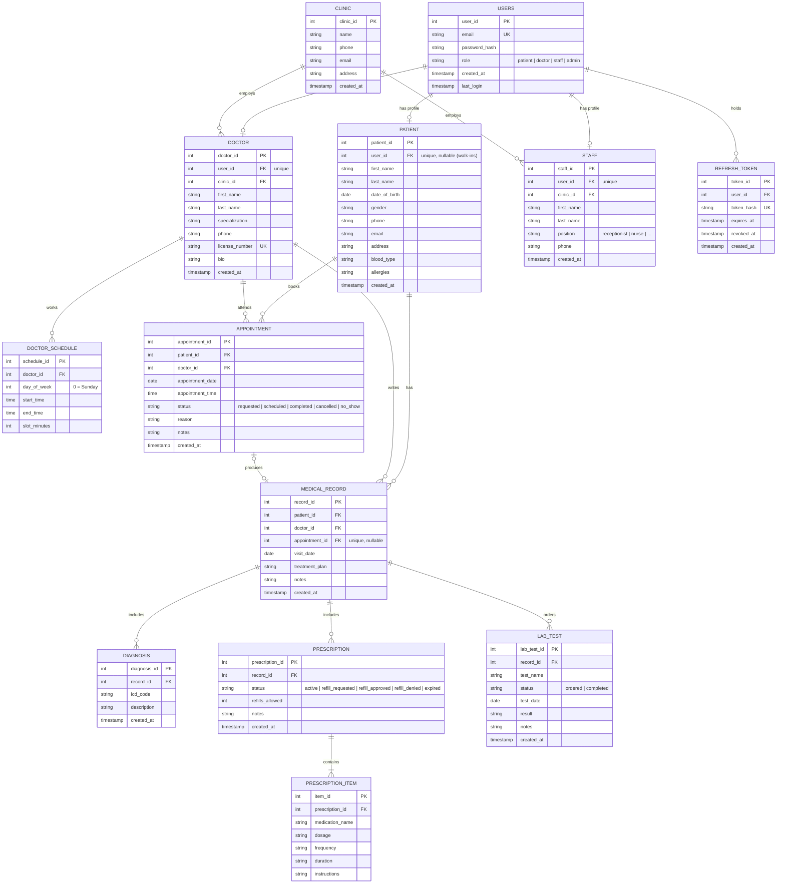

# Medical Clinic Portal: ER Diagram

To export as an image, paste the code block below into https://mermaid.live and choose **Actions → PNG/SVG**,
or open `er-diagram.html` in a browser.

## Relationships

| Relationship | Cardinality | Meaning |
|---|---|---|
| User – Patient / Doctor / Staff | 1 : 0..1 | A login account has at most one profile. Doctors and staff always have an account; walk-in patients may not. |
| User – Refresh Token | 1 : 0..* | One active token per logged-in device; logout revokes it. |
| Clinic – Doctor, Clinic – Staff | 1 : 0..* | The clinic employs doctors and staff. |
| Doctor – Doctor Schedule | 1 : 0..* | Weekly working hours, used to compute availability. |
| Patient – Appointment, Doctor – Appointment | 1 : 0..* | Each appointment has one patient and one doctor. A doctor can't be double-booked at the same date and time. |
| Patient – Medical Record, Doctor – Medical Record | 1 : 0..* | A record belongs to one patient and is written by one doctor. |
| Appointment – Medical Record | 0..1 : 0..1 | A completed visit produces at most one record. |
| Medical Record – Diagnosis / Prescription / Lab Test | 1 : 0..* | One visit can have many diagnoses, prescriptions and lab tests. |
| Prescription – Prescription Item | 1 : 1..* | A prescription lists one or more medications. |

## What changed from the first version (and why)

**Errors fixed**
1. **Patient and Doctor weren't linked to User** (only Staff was). They now have `user_id`; without it, `/users/me` and role-based access couldn't work.
2. **User `role` had no "staff" option** despite the Staff table. Added `staff`.
3. **"User manages Clinic" had no foreign key** in the Clinic table. Removed it (the admin role covers clinic management).
4. **Doctors weren't linked to the Clinic.** Added `clinic_id` to Doctor.
5. **`POST /records/{id}/diagnoses` had no table** (diagnosis was one column). New Diagnosis table, so a visit can have several diagnoses.
6. **`GET /prescriptions/{id}/items` had no items** (one medication per prescription). Split into Prescription + Prescription Item. Refill requests use the prescription's `status`.
7. **`GET /doctors/{id}/availability` had no data.** New Doctor Schedule table.
8. **`/auth/refresh` and `/auth/logout` had nowhere to store tokens.** New Refresh Token table.
9. **Lab Test, Clinic and Staff had no endpoints.** Added them.
10. **The description promised messaging and billing** with no tables or endpoints behind them. Removed from scope.

**Improvements**
- Removed duplicate data: `name` from Users, `email` from Doctor and Staff.
- A unique (doctor, date, time) rule prevents double booking.
- Each Appointment links to the Medical Record it produces.

Result: 9 → 13 tables, 25 → 38 endpoints.
